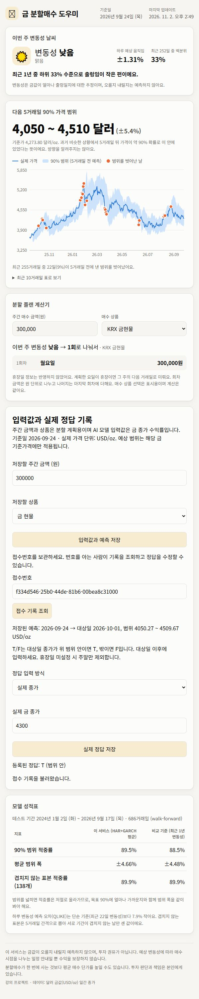

# 검증 증빙 (2026-11-02)

`local-web-flow.png`는 로컬 Vite → FastAPI → SQLite 통합 확인 화면입니다.
사용자 입력 300,000원, 숫자 정답 4,300 USD/oz와 T 입력은 **화면 검증용 테스트값**입니다.
실제 2026-10-01 종가를 확인한 자료가 아닙니다. AWS는 미설정(`disabled`)입니다.
CloudWatch/S3 실제 전송 증빙으로 사용할 수 없습니다.

- 기준 main: `f7998f5` (PR #2 병합).
- 기존 HAR+GARCH 모델/하이퍼파라미터/재학습 규칙 변경 없음.
- 실제 CSV: 가격 2,692행 로딩, 최근 520거래일 예측 저장.
- 배치 실행: `python -m gold_service.run_daily --date 2026-09-24` 종료 0.
- 예측: 기준가 4273.80 USD/oz, sigma 0.0131, LOW, 범위 4050.27~4509.67, z 약 1.832, fallback=False.
- `python -m gold_service.evaluate --start 2024-01-01`: 686거래일, 범위 적중률 89.5%, 평균 반폭 ±4.66%, QLIKE 개선율 +7.93%, 대체값 0일.
- Python 전체 테스트: 65 passed. 기존 미래값 변조/학습 타깃 제한/재학습/회귀 테스트 포함.
- 웹 테스트: 53 passed. 샘플 저장 차단, 입력 저장, 접수 조회, T/F·숫자 정답, 실패 안내 포함.
- `npm run build`: TypeScript 검사와 Vite 빌드 성공.
- 브라우저: 실제 API 예측 표시, 입력 저장, T/F 저장, 숫자 저장, 접수 재조회 확인.
- AWS 모의 테스트: S3/CloudWatch JSON 내용, 입력/정답 이벤트, 전송 실패 시 DB 유지, 실패 대상 재전송 및 성공 대상 생략 확인.

실제 AWS 자격증명/버킷/로그 설정과 전송 증빙은 미완료입니다. README 설정 후 실행하여 확인해야 합니다.
휴장일 파일 미제공으로 대상일 계산은 기존 주말 제외 달력을 사용했습니다.
Python 실행 환경의 httpx 사용 중단 예정 경고 및 pytest 캐시 권한 경고가 있었으나 테스트는 모두 통과했습니다.
기존 웹 의존성 npm audit에는 6건(보통 3, 높음 1, 심각 2)이 보고됐으며, 이번 기능 범위에서 강제 버전 변경은 하지 않았습니다.

